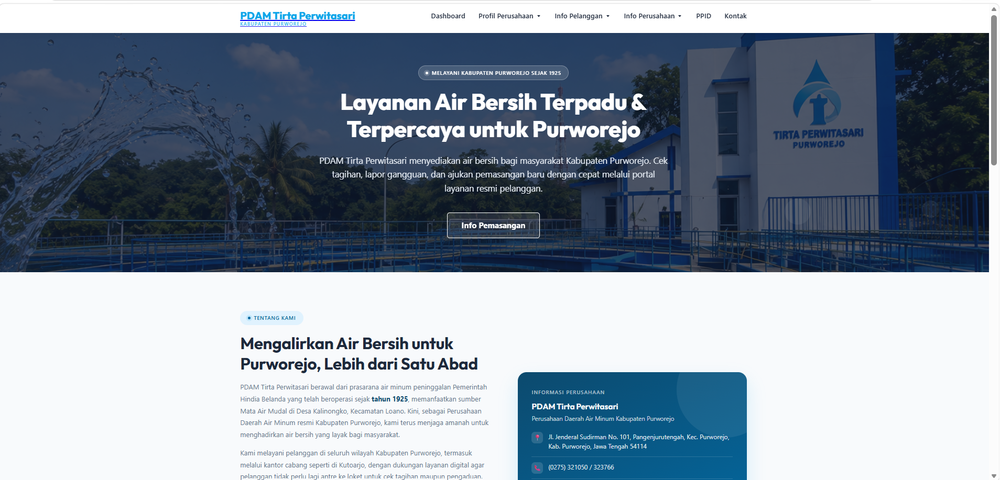
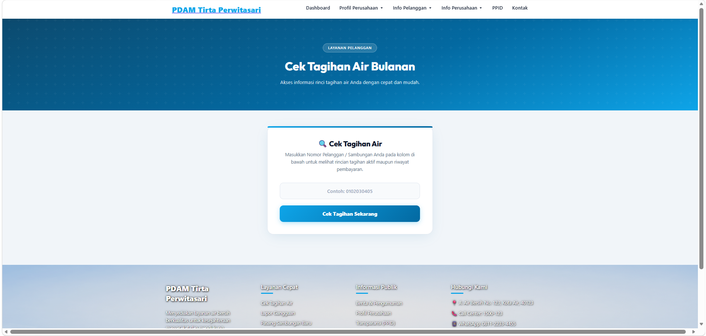
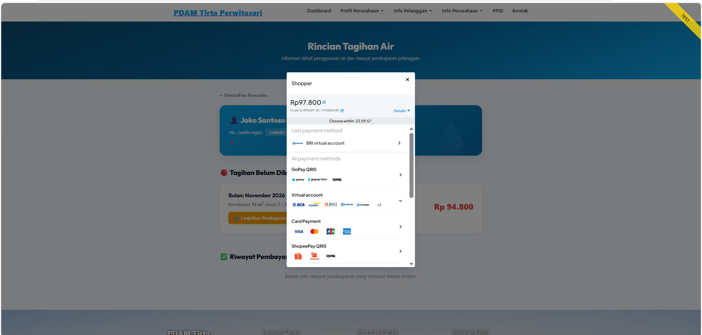
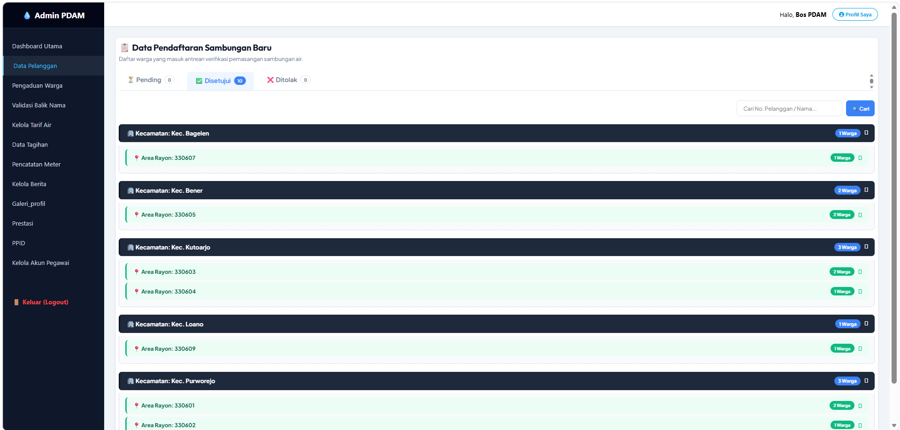

# Sistem Informasi PDAM Tirta Perwitasari Purworejo

Sistem informasi layanan PDAM berbasis web. Pelanggan bisa cek dan membayar tagihan secara online, mengajukan pasang baru dan balik nama, serta mengirim pengaduan. Petugas dan admin mengelola semuanya lewat panel admin dengan hak akses per peran dan data yang dipisah per cabang.

Dibuat sebagai proyek skripsi, S1 Sistem Informasi, Universitas AMIKOM Yogyakarta.

## Fitur

### Sisi pelanggan
- **Cek tagihan & bayar online** lewat Midtrans (Snap), lengkap dengan sinkronisasi status dan pembatalan pembayaran
- **Kwitansi PDF** yang bisa dicetak
- **Pendaftaran pasang baru**, cek status pemasangan, dan pembayaran RAB
- **Pengajuan balik nama** dengan pembayaran online
- **Pengaduan pelanggan**
- Halaman informasi: berita, tarif, PPID, profil, prestasi, FAQ, wilayah pelayanan, dan kontak

### Sisi admin
- **6 peran (RBAC):** `super_admin`, `kepala_cabang`, `kasir`, `petugas_meter`, `petugas_pemasangan`, `admin_berita`
- **Multi-branching:** data pelanggan dan pengaduan dipisah per cabang lewat `cabang_id`
- Pencatatan meter dan penerbitan tagihan, pelunasan manual, validasi pelanggan dan balik nama, input RAB
- Kelola tarif air, berita, profil, galeri, prestasi, dan user
- Dokumen sensitif pelanggan (KTP, berkas kepemilikan) disimpan di storage privat dan hanya bisa dibuka user yang sudah login

## Tampilan

### Beranda


### Cek tagihan pelanggan


### Pembayaran online via Midtrans (mode sandbox)


### Dashboard admin (data pendaftaran sambungan baru per kecamatan dan rayon)


## Teknologi

| Bagian | Teknologi |
|---|---|
| Backend | PHP 8.3, Laravel 13 |
| Database | MySQL |
| Frontend | Blade, Tailwind CSS 4, Vite |
| Pembayaran | Midtrans (Snap + webhook callback) |
| Lainnya | barryvdh/laravel-dompdf, Intervention Image |

## Cara menjalankan

Prasyarat: PHP 8.3+, Composer, Node.js, dan MySQL.

```bash
# 1. Install dependensi
composer install
npm install

# 2. Siapkan environment
cp .env.example .env
php artisan key:generate
```

Lalu edit `.env`:

```env
DB_CONNECTION=mysql
DB_DATABASE=db_pdam2
DB_USERNAME=root
DB_PASSWORD=

MIDTRANS_SERVER_KEY=isi_server_key_sandbox
MIDTRANS_CLIENT_KEY=isi_client_key_sandbox
MIDTRANS_IS_PRODUCTION=false
```

Key Midtrans sandbox bisa dibuat gratis di dashboard Midtrans.

```bash
# 3. Buat database db_pdam2 di MySQL, lalu:
php artisan migrate --seed
php artisan storage:link

# 4. Jalankan
npm run build
php artisan serve
```

Buka `http://127.0.0.1:8000`. Akun admin awal dibuat oleh `database/seeders/AdminSeeder.php`.

## Struktur singkat

```
app/Http/Controllers/   logika per fitur (Tagihan, Pelanggan, BalikNama, Pengaduan, dll.)
app/Http/Middleware/    RoleMiddleware (pembatasan akses per peran)
app/Models/             Pelanggan, Tagihan, Cabang, Pengaduan, TarifAir, dll.
database/migrations/    skema database
resources/views/        halaman publik dan panel admin (Blade)
routes/web.php          seluruh rute aplikasi
```

## Catatan

- File `.env`, folder `vendor/`, dan data upload pelanggan tidak disertakan di repositori ini.
- Pembayaran memakai Midtrans mode sandbox, jadi tidak ada transaksi uang sungguhan.

## Pengembang

Wahyu Ansyah, Universitas AMIKOM Yogyakarta
